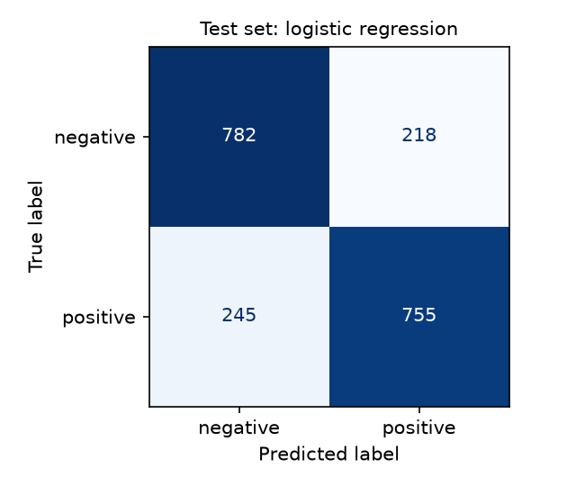
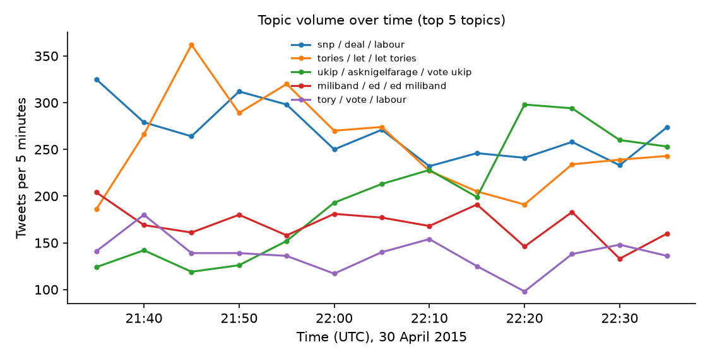

# Social Listening NLP

Sentiment classification, topic discovery and trend tracking on tweets, with a FastAPI endpoint for live predictions.

The project answers two questions a social listening team would ask:

1. **How positive or negative is a piece of text?** A sentiment classifier is trained on 10,000 labelled tweets and evaluated properly: cross-validation, a held-out test set, precision/recall/F1, a significance test between models and a label-leakage check.
2. **What are people talking about, and what is trending?** Topics are discovered without labels in 20,000 tweets about the 2015 UK general election, then tracked in 5-minute windows. A short insight brief is written from the results, either by template or by an LLM.

**Stack:** Python · pandas · NumPy · scikit-learn · SciPy · Matplotlib · NLTK · FastAPI · pytest · Docker · GitHub Actions

---

## Results

### 1. Sentiment classifier

Stratified 80/20 split (8,000 train / 2,000 test, balanced classes). TF-IDF features with unigrams and bigrams.

| Model | 5-fold CV macro-F1 (train) | Test accuracy | Test macro-F1 |
|---|---|---|---|
| **Logistic Regression** (selected) | 0.770 ± 0.008 | 0.769 | 0.769 |
| Multinomial Naive Bayes | 0.765 ± 0.014 | 0.766 | 0.765 |

Logistic Regression, test set: precision 0.76 (negative) / 0.78 (positive); recall 0.78 / 0.76.



**Is Logistic Regression actually better?** Not significantly. On the same 2,000 test tweets, the models disagree on 207: Logistic Regression is right on 106 of them and Naive Bayes on 101. An exact McNemar test gives **p = 0.78**, so the difference is not statistically significant. I kept Logistic Regression because it is slightly more balanced across classes and its coefficients are easy to interpret.

### 2. Finding: label leakage from emoticons

The labelled tweets were collected by searching for emoticons such as `:)` and `:(`, so the emoticon *is* the label. When emoticons are left in the text and tokenised, the same model scores:

| Text preprocessing | Test accuracy |
|---|---|
| Emoticons kept (leaky) | **98.7%** |
| Emoticons removed (this project) | **76.9%** |

The 98.7% only measures whether the model can spot `:)`, so it says nothing about how well it reads language. All reported results use the cleaned text. scikit-learn's default tokenizer drops punctuation, which hides this leak by accident. A tweet-aware tokenizer would expose it. The full numbers are in [`reports/metrics.json`](reports/metrics.json).

Strongest words learned by the model:
- **Positive:** thanks, happy, great, nice, morning, thank you, welcome, awesome
- **Negative:** miss, sad, sorry, why, wish, missing, tired, weather

Some positive features, such as "ff" (Follow Friday) and brand campaign hashtags, are artefacts of how the data was collected. That kind of bias is worth checking for before using a model on new data.

### 3. Topics and trends: 2015 UK general election

19,445 English tweets collected over about 70 minutes on the evening of 30 April 2015, during a BBC Question Time election special (#bbcqt is the top hashtag). 68% are retweets. Topics come from NMF (non-negative matrix factorisation) on the unique tweet texts, so heavily retweeted messages do not dominate them.

| Topic (top 3 terms) | Tweets | Share | Retweets |
|---|---|---|---|
| snp / deal / labour | 3,796 | 20% | 63% |
| tories / let / let tories | 3,574 | 18% | 80% |
| ukip / asknigelfarage / vote ukip | 2,828 | 14% | 65% |
| miliband / ed / ed miliband | 2,381 | 12% | 72% |
| tory / vote / labour | 1,966 | 10% | 58% |
| cameron / david / david cameron | 1,905 | 10% | 80% |
| farage / nigel / nigel farage | 1,819 | 9% | 49% |
| clegg / nick / nick clegg | 1,167 | 6% | 66% |

Top hashtags: #bbcqt (2,575), #asknigelfarage (1,144), #ukip (1,076), #snp (690), #ge2015 (602).



Conversation shifts during the evening. The SNP and Conservative topics peak in the first 15 minutes. The UKIP topic then climbs from about 120 to about 300 tweets per 5 minutes between 21:45 and 22:20, and the Farage topic rises from about 25 to about 230 over the same period.

Per-topic sentiment shares are saved in `reports/topics.json`, but I deliberately leave them out of this summary. The classifier was trained on everyday tweets, not political ones, and it was never validated on this domain. A brief generated from the results is in [`reports/insights.md`](reports/insights.md).

---

## Run it yourself

```bash
git clone https://github.com/SreyanBhattacharya/social-listening-nlp.git
cd social-listening-nlp
python -m venv .venv && source .venv/bin/activate   # Windows: .venv\Scripts\activate
make install        # or: pip install -r requirements-dev.txt && pip install -e .

make train          # sentiment models, metrics.json, confusion_matrix.png (downloads the NLTK corpus)
make topics         # topics.json, topics.png, topic_trend.png
make insights       # insights.md from a template
make test           # 12 unit and API tests
```

Optional LLM brief:

```bash
pip install google-genai           # or: pip install anthropic
export GEMINI_API_KEY=...          # or: export ANTHROPIC_API_KEY=...
export LLM_MODEL=<model name from the provider's docs>
python -m sociallistening.insights --provider gemini   # or --provider claude
```

The prompt sends only aggregated topic statistics, never raw tweets. It tells the model to use only the numbers provided and to stay politically neutral.

### API

```bash
make api            # http://127.0.0.1:8000/docs
```

```bash
curl -X POST http://127.0.0.1:8000/predict \
  -H "Content-Type: application/json" \
  -d '{"texts": ["Thanks so much, this is brilliant!", "Stuck in traffic again, worst day ever"]}'
```

```json
{"predictions": [
  {"text": "Thanks so much, this is brilliant!", "sentiment": "positive", "positive_probability": 0.8534},
  {"text": "Stuck in traffic again, worst day ever", "sentiment": "negative", "positive_probability": 0.2993}
]}
```

### Docker

```bash
docker build -t social-listening-nlp .
docker run -p 8000:8000 social-listening-nlp
```

---

## Project structure

```
src/sociallistening/
  data.py         load the NLTK twitter_samples corpus (personal fields dropped)
  preprocess.py   tweet cleaning: URLs, mentions, emoticons (leakage), hashtags
  train.py        LR vs NB, cross-validation, test metrics, McNemar test, leakage check
  topics.py       NMF topics, 5-minute trend tracking, hashtags, per-topic tone
  insights.py     template or LLM-written brief (Gemini / Claude)
  api.py          FastAPI service: /health, /predict
tests/            pytest suite (runs in CI without downloading data)
reports/          generated metrics and charts
```

## Limitations and next steps

- **Binary sentiment only.** Neutral text lands near 0.5 (for example, "The meeting is at 3pm" scores 0.49). A three-class dataset would handle this better.
- **Domain shift.** The model was trained on everyday tweets. Political or product-specific use would need labelled examples from that domain.
- **Short collection window.** About 70 minutes of data shows what trended within one evening, not long-term trends.
- **Next:** compare against a fine-tuned transformer such as DistilBERT; add retrieval (embeddings + vector search) so an LLM can answer questions grounded in the tweets themselves; extend trend tracking to multi-day data with anomaly detection.

## Data

[NLTK `twitter_samples`](https://www.nltk.org/nltk_data/) corpus, downloaded at run time and not stored in this repository. Its use is subject to Twitter's developer terms. The project removes URLs and @mentions during cleaning and does not publish individual tweets.

## License

MIT
